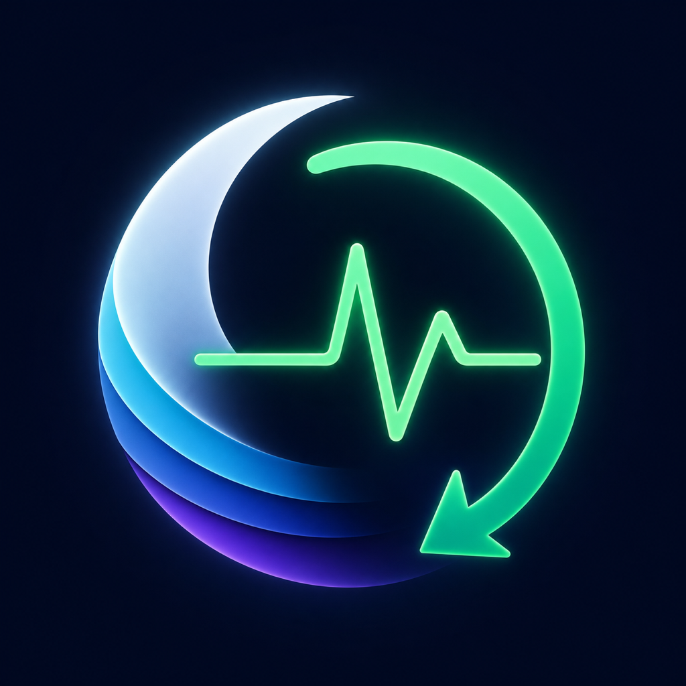

# HealthDataBridge

A free, open-source iOS app that fills gaps in Apple Health using data from your WHOOP account: sleep stages, heart rate, and optional recovery heart-rate variability (HRV/RMSSD).

**Experimental community project. Not affiliated with, sponsored by, or endorsed by WHOOP or Apple.** WHOOP and Apple trademarks belong to their respective owners.



## What it does

- Imports missing sleep stages and heart-rate samples, checking existing Apple Health coverage to reduce duplicates.
- Resumes from confirmed checkpoints and reconciles recent source revisions.
- Offers manual synchronization and an App Shortcut (`Sincronizar WHOOP` / `Sync WHOOP`) for personal automations.
- Optionally imports recovery **HRV in milliseconds (RMSSD)** on supporting iOS 27 devices. This is not WHOOP's recovery percentage and is not SDNN.
- Configures compatible data together, starts new users with seven days and offers one optional historical-period import with durable resume and cancellation.
- Preserves other sources' samples; cleanup is restricted to records identified as belonging to this app.
- Includes English and Spanish interfaces, local diagnostics and tests.

## Status and important limitations

Published baseline: **0.2.0 (6)**. The source candidate is **0.3.0 (7)** with unified setup and synchronization. See its [P01–P24 validation report](docs/VALIDATION_0.3.md) for executed checks and outstanding physical acceptance. No new personal-iPhone installation is claimed. Previous results are summarized in [Testing](docs/TESTING.md).

The app currently uses **private, undocumented WHOOP endpoints**, including its authentication flow. They can change or become unavailable. Publishing the source does not establish permission to use these endpoints: review [WHOOP's API terms](https://developer.whoop.com/api-terms-of-use/) and applicable service terms. No claim of WHOOP authorization is made. This license covers this project's code, not WHOOP services, data or trademarks.

HRV is disabled until configured. HealthKit does not disclose read-authorization status directly. A limited historical date boundary is respected; where full visibility cannot be established, configuration may require an explicit user confirmation. That confirmation is not an independently verified permission and does not detect a later hidden revocation.

Historical completion means the **period you specified** was traversed. It does not certify exhaustion of all WHOOP history. Check pending or manual-review items before treating an import as complete.

There is no app-managed background scheduler. Shortcuts need prior connection and setup; protected health data or credentials can be unavailable while the device is locked. No medical advice or diagnostic interpretation is provided.

## Install from source

There is currently **no App Store release, public TestFlight invitation or downloadable signed IPA**. A GitHub checkout is source code, not an installable iPhone app.

Requirements:

- A Mac with **Xcode 27 and the iOS 27 SDK** to build this branch completely.
- An iPhone with iOS 17 or later for sleep/heart-rate functionality; recovery RMSSD additionally requires a supporting iOS 27 runtime.
- Your own WHOOP account and an Apple signing team suitable for your installation method.

```sh
git clone https://github.com/xoselourido/health-data-bridge.git
cd health-data-bridge
open iOS/WHOOPHealthSync.xcodeproj
```

Select the `WHOOPHealthSync` scheme. Under **Signing & Capabilities**, select your own development team. For a new installation, use a unique bundle identifier; see [Build and identity](docs/BUILDING.md) before changing it. Select your iPhone and run. Connect your own WHOOP account, authorize Apple Health access and perform the first sync manually. Never put credentials into source files.

Existing maintainer installations keep their original bundle identifier and storage identifiers. The internal Xcode target and Swift modules retain their legacy names for continuity; the visible app is **HealthDataBridge**. An update with the same bundle ID and signing identity preserves the existing app container.

New users configure sleep, heart rate and compatible recovery HRV together after connecting WHOOP. Authorize the selected data, confirm applicable HRV source/read checks and choose **Save and sync**. Existing installations keep their usual button, session, historical scope and progress without repeating setup. **Options → Configure sync** changes selected data; **Import an earlier period** is the separate common historical action. See [Usage](docs/USAGE.md) and [continuity design](docs/UNIFIED_SYNC_DESIGN.md).

## Tests

```sh
swift test --jobs 2
swift run --jobs 2 WHOOPHealthSyncCoreChecks
bash scripts/verify_local.sh
```

The Swift package has no third-party package dependencies. GitHub Actions runs the core tests and core checks. HealthKit integration/UI tests require Xcode and an isolated simulator; they are not equivalent to the core CI job. See [Testing](docs/TESTING.md) for setup, previous results and remaining physical checks.

## Privacy and contributions

Tokens are stored locally in Keychain. Health data goes from WHOOP to Apple Health and local operational state; the app has no project-operated backend, advertising or third-party analytics SDK. [Privacy](PRIVACY.md) explains permissions and diagnostic handling.

Please use synthetic data in issues and pull requests. Never upload credentials, raw health exports, personal diagnostics, signing files or device identifiers. See [Contributing](CONTRIBUTING.md) and [Security](SECURITY.md).

## License

[MIT](LICENSE). Free to use, inspect and contribute to under that license. Access to WHOOP and Apple services remains subject to their own terms and requirements.
